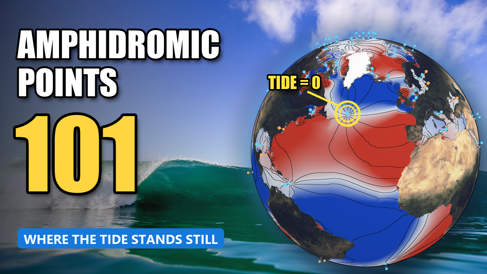

# Amphidromic Points 101: Where the Tide Stands Still

A beginner-friendly introduction to **amphidromic points**, with interactive models, the places in the ocean where the tide barely rises or falls, even though high and low tide sweep around them like the hands of a clock.

## Try them (they run in your browser, nothing to install)

| Model | What it shows | Live link |
|---|---|---|
| **Globe** | The real ocean tide (red = high, blue = low) with every major amphidromic point marked. Click anywhere to see a cross-section of the water, a tide gauge, and how the current underneath flips when the tide turns. | [amphidromic_earth.html](https://krimseylilleth.github.io/universe/liquid-universe/amphidromic_earth.html) |
| **Close-up** | A simple "baby pool" with one flat wave going around it, showing how a still point in the middle is possible. Also a wide-area view of a tide wave travelling around a channel. | [amphidromic_closeup.html](https://krimseylilleth.github.io/universe/liquid-universe/amphidromic_closeup.html) |

## Video walkthrough

*Coming soon.*

## Controls

- Drag to rotate, scroll to zoom
- Click the ocean (globe) to probe the tide at that spot
- **Press S** to hide / show all panels
- The globe can switch between tide constituents: **M2** (the Moon's twice-a-day tide, 12.42 h), **S2** (the Sun's, 12.00 h), and the once-a-day **K1** and **O1**

## Data

- **Tides:** NASA GOT4.10c ocean tide model (R. Ray, NASA Goddard), built from satellite altimetry since 1992, on a 0.5° grid. <https://earth.gsfc.nasa.gov/geo/data/ocean-tide-models>
- **Sea floor depth:** NOAA ETOPO1, averaged to 0.5°. <https://www.ncei.noaa.gov/products/etopo-global-relief-model>
- Currents are calculated from the slope of the tide surface and Earth's rotation (linear, frictionless), not measured. See the "Honest notes" in the globe's panel for the limits.

## Files

- `amphidromic_earth.html`: the globe
- `amphidromic_closeup.html`: the close-up (self-contained)
- `amphidromic_got410c_data.js`, `amphidromic_bathy_data.js`: tide and depth data used by the globe

## Suggestions welcome

Ideas or fixes? [Open an issue](https://github.com/KrimseyLilleth/universe/issues), or click the pencil icon on any file to propose an edit.

Thumbnail photo: Austin Schmid via Unsplash (CC0).

Krimsey Lilleth · klilleth@proton.me
